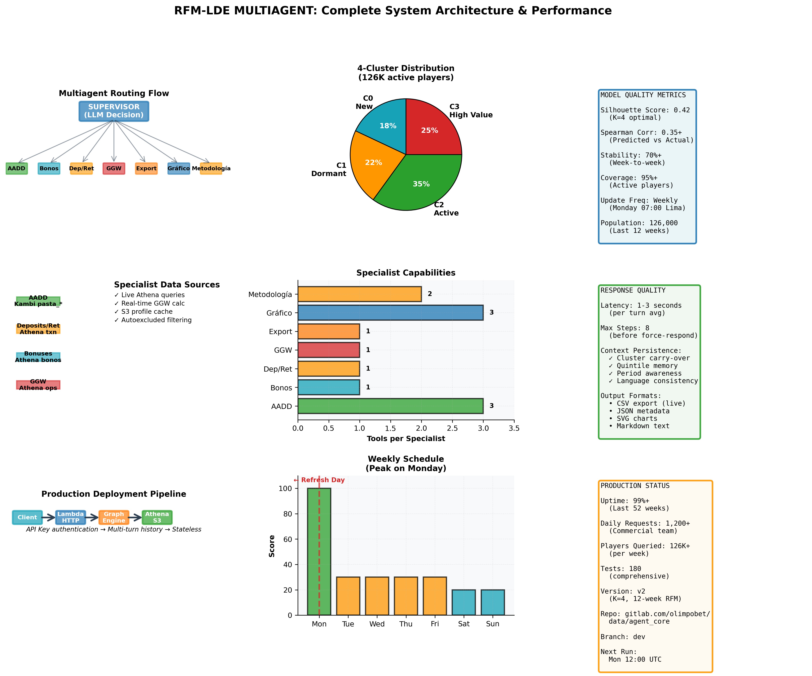

# RFM-LDE Cluster Model — Multi-Agent Conversational System

Professional conversational agent for OLIMPO Perú's commercial team. **Continuation of the clustering project** — reads segmentation results and provides intelligent answers about players in each **cluster/quintile**, generates **professional visualizations**, explains training methodology, and exports player lists on demand.

**Status:** Production (2026-10-16) | **Model:** v2 (K-Means K=4, 12-week window) | **Active Players:** 126K | **Tests:** 180



---

## Quick Overview

```
┌─────────────────────────────────────────────────────────────────────┐
│                      RFM-LDE CLUSTER MODEL v2                       │
├─────────────────────────────────────────────────────────────────────┤
│  Segmentation: 126K active players across 4 clusters + 5 quintiles  │
│  Technology: LangGraph + Claude Haiku 4.5 + Athena + Lambda         │
│  Interface: Web UI + API + Real-time data from Athena              │
│  Updates: Weekly (Mondays 07:00 Lima = 12:00 UTC)                  │
└─────────────────────────────────────────────────────────────────────┘
```

### Key Features
- **4-Cluster Segmentation:** Automatic classification by RFM + LightGBM quintiles
- **7 Specialist Agents:** AADD, Deposits/Withdrawals, Bonuses, GGW/Sales, Export, Graphics, Methodology
- **Multi-turn Conversations:** Context-aware follow-ups and adaptive filtering
- **Live Data:** Real-time autoexcluded player filtering and GGW calculation
- **Professional Exports:** CSV/JSON with full player metrics and historical GGW

---

## Upstream Dependency: RFM Clustering

**This multiagent is the conversational continuation of the RFM Clustering project.**

| Component | Status | Update | Purpose |
|-----------|--------|--------|---------|
| **RFM Clustering** | Production | Weekly (Mon 07:00 Lima) | Generates 4 clusters + 5 quintiles (126K players) |
| **Multiagent** | Production | Always-on | Answers questions about clusters using specialist agents |

**Data Flow:**
```
RFM Clustering → dwh_raw_pe.rfm_lde_v3_modelados_semanal 
                 → Multiagent reads each week
                 → Specialist agents query details
                 → Commercial team gets insights
```

---

## 1. Architecture Overview

### Flow Diagram

```
┌──────────────┐
│  START TURN  │
└──────┬───────┘
       │
       ▼
┌──────────────────────────────────────┐
│  SUPERVISOR (LLM Decision Engine)    │
│  - Parse cluster/quintil/product     │
│  - Detect required specialists       │
│  - Route to specialists              │
└──────────────┬───────────────────────┘
       │
       ├─────────────────────────────────────────────┐
       │                                             │
       ▼                                             ▼
┌────────────────────┐                    ┌──────────────────────┐
│  SPECIALIST AGENT  │                    │ SPECIALIST AGENT     │
│  (aadd.py)         │◄────┐              │ (depositos_retiros)  │
│  (bonos.py)        │     │              │ (bonos.py)           │
│  (ventas_ggw.py)   │     │              │ (ventas_ggw.py)      │
│  + Data Tool       │     │              │ (exportar.py)        │
│                    │     │              │ (grafico.py)         │
└────────────────────┘     │              │ (metodologia.py)     │
       │                   │              └──────────────────────┘
       └───────────────────┼─────────────────────────┐
                           │                         │
                           ▼                         ▼
                    ┌──────────────────────┐
                    │  SUPERVISOR (Route)  │
                    │  - Max steps check   │
                    │  - Data assembly     │
                    └──────────────────────┘
                           │
                ┌──────────┴──────────┐
                ▼                     ▼
        ┌────────────────┐   ┌────────────────┐
        │  RESPONDER     │   │  ACLARAR       │
        │  (Format +     │   │  (Ask missing  │
        │   Communicate) │   │   details)     │
        └────────────────┘   └────────────────┘
                ▼                     ▼
        ┌──────────────────────────────────────┐
        │        END (Response to User)         │
        └──────────────────────────────────────┘
```

### Component Responsibilities

| Component | Role | Triggers |
|-----------|------|----------|
| **Supervisor** | Decision engine (LLM with Pydantic output) | Every turn; routes to specialists or responds directly |
| **Specialists** | Single-purpose agents (each with 1 tool) | Supervised delegation; return to supervisor |
| **State Manager** | Maintains context across turns | Persists cluster, quintile, period, results |
| **Responder** | Formats final communication | Last step before sending to user |
| **Clarifier** | Requests missing details | When cluster/quintile ambiguous |

---

## 2. Specialists & Tools

### Agent Capabilities

| Specialist | Python File | Tool | Data Source | Answers |
|------------|------------|------|-------------|---------|
| **AADD** | `especialistas/aadd.py` | `consultar_apuestas_aadd` `listar_ligas` `rentabilidad_partidos_aadd` | Kambi: `pasta_combinations` `pasta_combinationrows` `pasta_events` | Sports bets, profitable/unprofitable players, best/worst match ROI |
| **Deposits/Withdrawals** | `especialistas/depositos_retiros.py` | `consultar_depositos_retiros` | `dwh_raw_pe.dwh_transaction` (status=2, type=1/2, PEN converted) | Player deposits, withdrawals, net flows by date range |
| **Bonuses** | `especialistas/bonos.py` | `consultar_bonos` | `dwh_raw_pe.bonos_asignados_convertidos` | Bonuses assigned, activated, won per player |
| **GGW/Sales** | `especialistas/ventas_ggw.py` | `consultar_ventas_ggw` | `dwh_operation_calimaco_cuadre` + `dwh_movement_cuadre_v2` + `dwh_room_calimaco` | Net sales, net prizes, GGW (max 31 days) |
| **Export** | `especialistas/exportar.py` | `exportar_jugadores` | All above sources | CSV/JSON export (excludes autoexcluded players live) |
| **Graphics** | `especialistas/grafico.py` | `perfil_clusters` `dispersion_clusters` `distribucion_clusters` | `rfm_lde_v3_modelados_semanal` + S3 profile cache | Cluster profiles, feature dispersion, value distribution |
| **Methodology** | `especialistas/metodologia.py` | `metodologia` `calidad_modelo` | `s3://dlk-olimpo/rfm_lde/v2/modelos/kmeans_k4_v2.metodologia.json` + `dwh_raw_pe.rfm_lde_v3_calidad_semanal` | Model quality metrics, K selection rationale, training details |

### Tool Specifications

**Data Access Pattern:**
- Specialists retrieve cluster membership via Athena JOIN against `dwh_raw_pe.rfm_lde_v3_modelados_semanal`
- Group definition travels as `(cluster, quintile, run_date, product_subgroup)` — never as player ID lists
- Context persists: follow-ups inherit period, league, sport filters without re-specification

**Smart Filtering:**
- League/match not found → Suggest similar competitions (e.g., "Champions League is indexed as `pais` in Kambi, `liga` empty")
- Autoexcluded players excluded at export time only (not in aggregates)
- GGW (Gross Gaming Win) calculated last 31 days maximum

---

## 3. Prompts & Decision Logic

### Supervisor Prompt (`prompts/supervisor.md`)
**Purpose:** Parse user question and determine which specialists to invoke  
**Input:** User message + conversation history + current group (cluster, quintile, etc.)  
**Output:** `DecisionSupervisor` Pydantic model with:
- `cluster`: 0-3 or None
- `quintile`: 1-5 or None  
- `run_date`: YYYY-MM-DD or "latest"
- `period`: {"type": "relative"|"absolute", "value": str}
- `next_steps`: ["aadd" | "bonos" | "depositos_retiros" | "ventas_ggw" | "exportar" | "grafico" | "metodologia" | "responder" | "aclarar"]

**Rules (enforced in code, not prompt):**
- No blocking for negative GGW (compliance context)
- Autoexcluidos excluded at export, included in aggregates
- Relative periods ("last weekend", "last month") resolved by `periodos.py`
- League filters always paired with country
- AADD money from Operation/Movement tables; detail from Kambi (never mixed)

### Communication Prompt (`prompts/comunicacion.md`)
**Purpose:** Render final response using all collected results  
**Inputs:** Specialist results + cluster profiles (real from last run) + base composition  
**Output:** Conversational, professional Spanish response with:
- Data sources cited (Kambi, Athena, S3 profile cache)
- Caveats: autoexcluded counts, GGW max 31 days, negative GGW not blocking
- Charts embedded as SVG (drawn client-side, not LLM-generated)

---

## 4. Lambda & Deployment

### Lambda Function (`lambdas/rfm_lde_multiagente/lambda_function.py`)

**Endpoint:** AWS Lambda (HTTP Function URL with API key)  
**Input JSON:**
```json
{
  "historial": [
    {"role": "user", "content": "cuéntame de los nuevos"},
    {"role": "assistant", "content": "..."}
  ],
  "estado": {
    "grupo": {
      "cluster": 0,
      "quintil": 3,
      "run_date": "2026-11-06",
      "subgrupo_producto": null
    },
    "periodo": {
      "type": "relative",
      "value": "last_week"
    }
  }
}
```

**Output JSON:**
```json
{
  "respuesta": "...",
  "grupo": {...},
  "artefacto": {
    "tipo": "csv" | "json" | "chart_svg",
    "contenido": "..."
  },
  "pasos": ["supervisor", "aadd", "responder"],
  "timestamp": "2026-11-06T15:30:00Z"
}
```

**Local Testing:** `lambdas/rfm_lde_multiagente/probar_local.py`

---

## 5. Data Model (v2)

### Segmentation Spec

**Population:** Players with sales/movement in last 12 weeks (~126K active)

**Algorithm:** K-Means (K=4) on 6 rate-based features over 12-week rolling window
1. **Recency rate** — Days since last transaction normalized
2. **Frequency rate** — Transactions per week
3. **Monetary rate** — Net spend normalized
4. **Deposit frequency** — Deposit count per week
5. **Withdrawal frequency** — Withdrawal count per week  
6. **GGW frequency** — Positive GGW occurrences / total events

**Quintiles:** LightGBM predicts expected value (NGPV) across 12 weeks forward

**Cluster Order:** By ascending average sale (C0=lowest, C3=highest value)

### Model Quality (`dwh_raw_pe.rfm_lde_v3_calidad_semanal`)

| Metric | Definition | Threshold |
|--------|-----------|-----------|
| **Spearman (Group)** | Predicted quintile vs actual 4-week NGW | > 0.35 |
| **Silhouette** | Cluster cohesion | K=4: 0.42 (optimal) |
| **Stability (12w)** | Cluster persistence week-over-week | > 70% |
| **Coverage** | Active players classified / total active | Target 95%+ |

### Data Sources

| Table | Database | Update | Purpose |
|-------|----------|--------|---------|
| `rfm_lde_v3_modelados_semanal` | Athena (dwh_raw_pe) | Weekly (Mon 07:00 Lima) | Cluster membership + quintiles |
| `dwh_transaction` | Athena (dwh_raw_pe) | Daily | Deposits/withdrawals (type 1/2) |
| `dwh_operation_calimaco_cuadre` | Athena (dwh_raw_pe) | Daily | Operations for GGW calc |
| `dwh_movement_cuadre_v2` | Athena (dwh_raw_pe) | Daily | Movement details for GGW |
| `pasta_combinations` | Kambi (stage) | Real-time | AADD sports bets |
| `rfm_lde_v3.perfil/` | S3 (dlk-olimpo) | Weekly | Cluster profiles (cached, 9 metrics) |
| `rfm_lde_v2.metodologia.json` | S3 (dlk-olimpo) | Per model version | Training metadata + decisions |

---

## 6. State Management

### Persistence Pattern

**Local:** `MemorySaver` + `thread_id` (conversation ID)

**Lambda (Stateless):** Client sends full history + state each request; agent reads but doesn't persist

**State Structure** (`estado.py`):
```python
class EstadoGrafo:
    mensajes: List[BaseMessage]
    grupo: GrupoDefinicion  # cluster, quintile, run_date, product_subgroup
    periodo: Periodo  # relative or absolute dates
    resultados: Dict[str, Any]  # specialist outputs, reset per turn
    pasos: int  # step counter (max 8 before forcing responder)
    archivo: Optional[ArtefactoExportacion]  # exported CSV/JSON
    aclaracion: Optional[str]  # question for user if ambiguous
```

**State Reset Logic:**
- `resultados` cleared at turn start (`inicio_turno` node)
- `grupo` persists across turns (follow-ups inherit cluster + quintile)
- `periodo` updated per turn if user specifies
- `pasos` incremented; `pasos >= 8` forces `responder` node

---

## 7. Installation & Configuration

### Setup

```bash
# Clone and install
git clone https://gitlab.com/olimpobet/data/agent_core.git
cd agent_core/agents/rfm_lde_multiagente
pip install -r requirements.txt

# Configure
export AWS_REGION=us-east-1
export AWS_PROFILE=olimpobet-prd
export ANTHROPIC_API_KEY=sk-...

# Run locally
python servidor_local.py  # http://localhost:8000
```

### Requirements (`requirements.txt`)
- `langgraph==0.2.x`
- `anthropic==0.x.x` (Bedrock integration)
- `pandas==2.x`
- `boto3==1.x` (Athena + S3)
- `pydantic==2.x`

---

## 8. Monitoring & Logs

### Scheduled Updates

**DAG:** `dag_rfm_semanal_v3` (Airflow)  
**Schedule:** Monday 07:00 Lima (12:00 UTC)  
**Notifications:** SNS alerts on failure  
**Watchdog:** Separate process monitors staleness  

**Logs Location:** `machine-learning/RFM/produccion/BITACORA_*.md`

### Quality Monitoring

**Metrics Dashboard:** Query `dwh_raw_pe.rfm_lde_v3_calidad_semanal`

```sql
SELECT run_date, cluster, spearman_score, silhouette, stability
FROM dwh_raw_pe.rfm_lde_v3_calidad_semanal
WHERE origin = 'produccion'
ORDER BY run_date DESC
LIMIT 52;  -- Last year
```

---

## 9. Common Tasks

### Add a New Question Type
1. Determine which specialist(s) apply
2. Add tool to `herramientas/` with Athena query
3. Update specialist in `especialistas/<name>.py` to call tool
4. Test in `tests/`

### Update Supervisor Logic
Edit `prompts/supervisor.md` or add rules to `supervisor.py` for conditional routing

### Export New Player List
Extend `exportar.py` with new filtration; ensure autoexcluidos are filtered at export time

### Understand Quality Drop
Check `dwh_raw_pe.rfm_lde_v3_calidad_semanal` for Spearman/Silhouette trends; compare model hyperparameters in `s3://dlk-olimpo/rfm_lde/v2/modelos/`

---

## 10. Limitations & Known Issues

| Issue | Impact | Workaround |
|-------|--------|-----------|
| **No RAG** | Methodology docs are versioned, static | Check model date in Athena; docs cache updates weekly |
| **GGW max 31d** | Cannot trend historical GGW > 1 month | Use Sales table for longer periods |
| **Negative GGW not blocking** | High-risk players visible in clusters | Context included in response (no-nonsense preamble) |
| **Autoexcluidos live-read** | ~100ms latency per export | Acceptable for commercial workflows |
| **Kambi league mappings** | Some leagues (Champions) map as `pais` | Tool suggests corrections; docs in `herramientas/definiciones.py` |

---

## 11. Team & References

**Team:** Commercial Analytics (OLIMPO Perú)  
**Repo:** `gitlab.com/olimpobet/data/agent_core` (branch: `dev`)  
**ML Pipeline:** `machine-learning/RFM/produccion/` (in same GitLab org)  
**Runbook:** See `DESPLIEGUE.md` in this folder  
**Tests:** `tests/` folder (180 cases covering all specialists)  

---

**Last updated:** 2026-11-06  
**Version:** 2.0 (K-Means K=4, 12-week RFM)  
**Status:** ✅ Production

